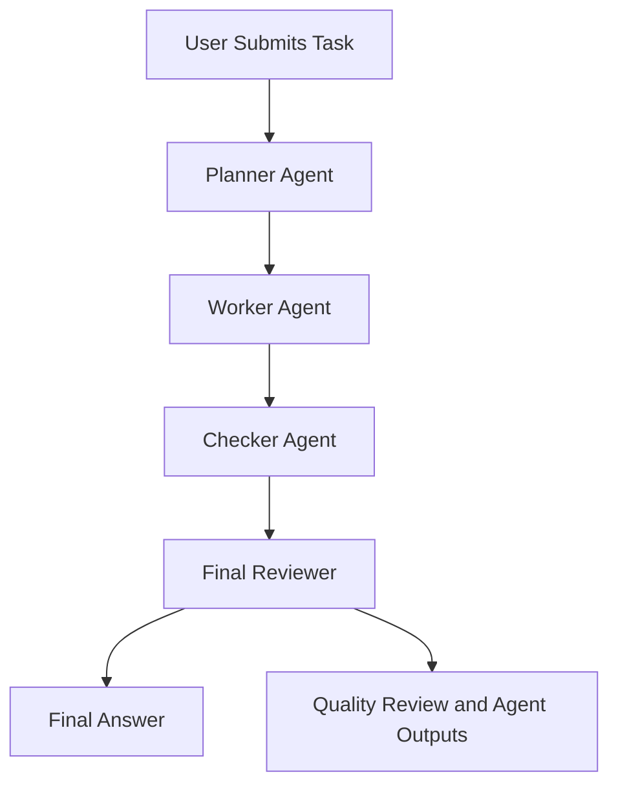

# 🤖 Parallel Multi-Agent AI System

An AI-powered task execution application built with **Python, CrewAI, Groq API, and Streamlit**. The system uses four specialized AI agents to plan, execute, review, and refine user tasks through a coordinated workflow.

## 📌 Project Overview

The Parallel Multi-Agent AI System demonstrates how multiple AI agents can collaborate to complete a user's request. Each agent has a specific responsibility, helping organize the task execution process and improve the quality of the final output.

Users can submit tasks through a Streamlit web interface and view the final answer, quality review, and individual agent outputs.

## ✨ Features

- **Multi-Agent Architecture:** Four specialized AI agents collaborate to process user requests.
- **Task Planning:** The Planner Agent breaks down the user's request into a structured plan.
- **Task Execution:** The Worker Agent generates the requested output.
- **Quality Checking:** The Checker Agent evaluates the output against the user's requirements.
- **Final Review:** The Final Reviewer prepares the final response using the task results and review.
- **Interactive Web Interface:** A user-friendly Streamlit application.
- **Groq API Integration:** Uses a Groq-compatible language model through the configured LLM integration.
- **Task Results:** View the final answer, quality review, and agent outputs.
- **Multiple Task Types:** Supports tasks such as explanations, writing, coding assistance, and structured content generation.

## 🏗️ System Architecture

The application follows a four-agent workflow.



### The Four AI Agents

| Agent | Responsibility |
|---|---|
| **1. Planner Agent** | Understands the task and creates a plan with completion criteria. |
| **2. Worker Agent** | Executes the task and generates the requested deliverable. |
| **3. Checker Agent** | Reviews the worker's output against the user's explicit requirements. |
| **4. Final Reviewer** | Produces the final response after considering the task results and review. |

**Workflow note:** The application coordinates the agents through CrewAI. The current implementation uses a sequential crew process, with the Planner and Worker tasks configured for asynchronous execution. This does not mean all four agents execute simultaneously.

## 🛠️ Technology Stack

- **Programming Language:** Python
- **AI Agent Framework:** CrewAI
- **LLM Provider:** Groq API
- **Web Framework:** Streamlit
- **LLM Integration:** LiteLLM through the configured CrewAI integration
- **Version Control:** Git and GitHub
- **Deployment Platform:** Streamlit Community Cloud

## 📂 Project Structure

```text
parallel-multi-agent-ai-system/
│
├── app.py
├── crew_runner.py
├── llm_config.py
├── requirements.txt
├── README.md
│
└── agents/
    ├── planner_agent.py
    ├── worker_agent.py
    ├── checker_agent.py
    └── final_reviewer_agent.py
```

*This structure represents the project's main files. Additional configuration files may exist in the repository.*

### Main Files

- `app.py` — Streamlit user interface and application pages.
- `crew_runner.py` — Creates the agents, defines tasks, coordinates execution, and collects results.
- `llm_config.py` — Configures the language model connection.
- `agents/planner_agent.py` — Defines the Planner Agent.
- `agents/worker_agent.py` — Defines the Worker Agent.
- `agents/checker_agent.py` — Defines the Checker Agent.
- `agents/final_reviewer_agent.py` — Defines the Final Reviewer.
- `requirements.txt` — Lists the Python dependencies.

## ⚙️ Setup and Installation

### Prerequisites

Before running the application locally, you need:

- Python installed on your computer.
- A GitHub account to access the source code.
- A Groq API key.
- Internet access for API requests.

### Step 1: Clone the Repository

Open a terminal and run:

```bash
git clone https://github.com/hinaarshad302/parallel-multi-agent-system.git
```

Move into the project folder:

```bash
cd parallel-multi-agent-system
```

### Step 2: Install Dependencies

Install the packages listed in `requirements.txt`:

```bash
pip install -r requirements.txt
```

### Step 3: Configure Environment Variables

The application requires a Groq API key and a model name.

For local Streamlit development, create the following file:

```text
.streamlit/secrets.toml
```

Add your configuration:

```toml
GROQ_API_KEY = "your_groq_api_key"
GROQ_MODEL = "openai/gpt-oss-120b"
```

Replace `your_groq_api_key` with your own API key.

**Security warning:** Never publish your real API key in source code, GitHub commits, screenshots, or public files. Keep `secrets.toml` out of version control.

### Step 4: Run the Application

Start the Streamlit application:

```bash
streamlit run app.py
```

Streamlit will display the local address for opening the application in your browser.

## ☁️ Deployment on Streamlit Community Cloud

You can deploy the project using your GitHub repository.

1. Push the project files to GitHub.
2. Open [Streamlit Community Cloud](https://share.streamlit.io/).
3. Sign in and create a new app.
4. Select the `parallel-multi-agent-system` repository.
5. Choose the branch containing your project.
6. Set the main application file to `app.py`.
7. Open the app's **Settings → Secrets** section.
8. Add your Groq configuration:

```toml
GROQ_API_KEY = "your_groq_api_key"
GROQ_MODEL = "openai/gpt-oss-120b"
```

9. Save the secrets and deploy the application.

Use the same secret names that your `llm_config.py` expects. The model name shown above is the project's configured default and must be supported by the provider and integration versions in use.

## 🚀 How to Use the Application

1. Open the deployed Streamlit application.
2. Navigate to **New Task**.
3. Enter a clear task or question.
4. Run the task.
5. Review the **Final Answer**.
6. Open **Quality Review** to inspect the Checker Agent's evaluation.
7. Open **Agent Outputs** to inspect the individual agents' results.

For the best results, describe your requirements clearly, including the desired language, format, number of bullet points, or output length.

### Example Task

```text
Explain Artificial Intelligence in 5 simple bullet points.
Do not add an introduction or conclusion.
```

The system should produce five bullet points, evaluate the response against the requirements, and display the final answer.

## 🔍 Quality Review

The Checker Agent evaluates the Worker Agent's deliverable against the original user request.

The review uses the following statuses:

- `COMPLETE` — All explicit requirements are satisfied.
- `PARTIAL` — Some requirements remain unmet.
- `NOT COMPLETE` — Important requirements have not been satisfied.

The review may identify fulfilled requirements, verified gaps, and necessary next steps. As with any LLM-based system, the review is not guaranteed to be correct and should be checked when necessary.

## 🔐 Environment Variables and Secrets

| Secret | Purpose |
|---|---|
| `GROQ_API_KEY` | Authenticates requests to the Groq API. |
| `GROQ_MODEL` | Specifies the language model used by the application. |

Never share your API key with other people. If it is exposed publicly, revoke it and generate a replacement.

## 🧰 Troubleshooting

### 1. Groq API Authentication Error

**Possible causes:**
- The API key is missing or incorrect.
- The secret name does not match the name expected by the application.
- The API key is no longer valid.

**What to check:** Verify `GROQ_API_KEY` in Streamlit Secrets and confirm that the key is valid.

### 2. Model or API Request Error

**Possible causes:**
- The configured model is unavailable to the account.
- The provider does not support a parameter sent by the installed integration.
- Package versions are incompatible.

**What to check:** Confirm the supported model name and inspect the full error message and installed package versions.

### 3. `cache_breakpoint` Error

If the Groq API returns an error mentioning an unsupported `cache_breakpoint` property, the issue may involve compatibility between CrewAI, LiteLLM, and the Groq API integration.

**What to check:**
- Review the installed versions of CrewAI and LiteLLM.
- Check the current compatibility documentation for the installed versions.
- Use a verified compatible dependency configuration or integration fix.
- Redeploy and test the application after making changes.

A compatibility workaround should not be considered successful until the application has been tested again.

### 4. Application Does Not Start

- Check the Streamlit deployment logs.
- Confirm that `app.py` exists in the selected branch.
- Confirm that `requirements.txt` includes the required dependencies.
- Check for Python import errors and missing modules.

## ⚠️ Current Limitations

- **Session-based history:** Task history is temporary and may be lost when the application session resets.
- **No persistent database:** Long-term storage of tasks and results is not implemented in the described workflow.
- **No live progress tracking:** The application does not currently provide verified real-time progress updates for each agent.
- **LLM-dependent results:** Output quality depends on the model, prompt instructions, and API availability.
- **Sequential crew orchestration:** The current crew uses `Process.sequential`; the system is not a fully parallel execution pipeline.
- **API dependency:** Task execution requires a working connection to the configured LLM provider.

## 🔮 Future Improvements

Possible future enhancements include:

- Persistent task history using a database.
- Real-time agent status and progress indicators.
- Retry logic and improved API error handling.
- More reliable dependency version pinning.
- Downloadable task reports.
- User authentication and task-specific history.
- Configurable agents and model selection.
- Automated tests for task completion and review accuracy.
- Performance monitoring and API usage tracking.

These are potential improvements and are not claimed as completed features.

## 🎓 Learning Objectives

This project demonstrates practical concepts in:

- Multi-agent AI system design.
- AI agent roles and task delegation.
- CrewAI task orchestration.
- LLM integration using an API.
- Python application development.
- Streamlit interface development.
- Prompt engineering and output evaluation.
- GitHub-based project management.
- Cloud deployment and secrets management.

## 👩‍💻 Author

**Hina Arshad**

GitHub: [hinaarshad302](https://github.com/hinaarshad302/)

## 📄 License

No license has been specified here. Add a `LICENSE` file and update this section if you decide to distribute the project under an open-source license.

## 🙌 Acknowledgements

- [CrewAI](https://www.crewai.com/) — AI agent orchestration framework.
- [Groq](https://groq.com/) — LLM inference platform.
- [Streamlit](https://streamlit.io/) — Python application framework.
- [GitHub](https://github.com/) — Source code hosting and version control.
